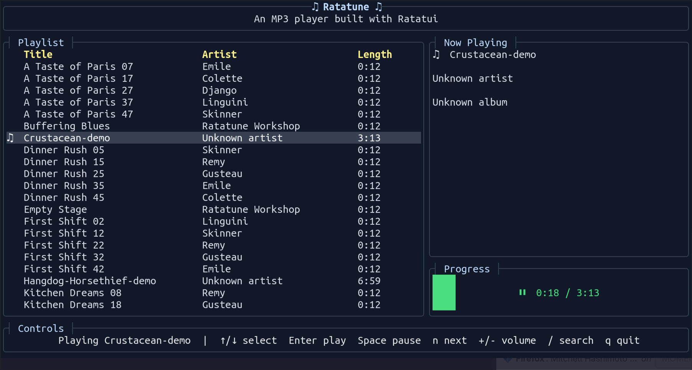

In this hands-on workshop, you will use [Ratatui](https://ratatui.rs), the Rust framework for building terminal user interfaces, to build **Ratatune**: a terminal music player for local MP3 files.

### What will you build?



### Who is this workshop for?

The workshop is intended for Rust beginners who want to learn how to build TUIs with Ratatui. Previous experience with Rust is not required, but a basic understanding of the language is recommended.

- If you are already familiar with Rust, you can still follow along and learn about Ratatui.
- If you are already familiar with Ratatui, follow the _bonus tracks_ and add more features!

> [!TIP]
> It is recommended to disable AI completions in your code editor to get a better understanding of the code you write.

#### Necessary Tools

- [Rust](https://www.rust-lang.org/tools/install) and `cargo`
- A code editor with Rust support
- A terminal emulator
- Headphones or speakers for playback

> [!NOTE]
> On Linux, install the ALSA and PulseAudio development packages before building the audio dependencies (for example, `libasound2-dev` and `libpulse-dev` on Debian/Ubuntu).

### Chapters

The workshop is split into 5 chapters and aims to be completed **in 3 hours**.

| Duration   | Chapter       | Topic                                                              |
| ---------- | ------------- | ------------------------------------------------------------------ |
| **10 min** | **Chapter 1** | **Setup** - Create the project from template                       |
| **15 min** | **Chapter 2** | **Manage State** - Load local MP3 files and show them              |
| **30 min** | **Chapter 3** | **Widgets** - Render a table and navigate with the arrow keys      |
| **45 min** | **Chapter 4** | **Layout & Styling** - Split the screen into multiple widget areas |
| **20 min** | **Chapter 5** | **Interactivity** - Navigate, search and control playback          |
| **60 min** | 🧀            | **Q&A** + **Bonus tracks**                                         |

### Walkthrough

1. Install [`cargo-generate`](https://github.com/cargo-generate/cargo-generate):

```sh
cargo install --locked cargo-generate
```

2. Generate a project from this workshop repository:

```sh
cargo generate --git https://github.com/orhun/ratatui-music-player-workshop
```

3. Use the [slides](presentation.md) to follow along with the workshop.

> [!TIP]
> You can use [`presenterm`](https://github.com/mfontanini/presenterm) to present the slides in your terminal.
>
> ```sh
> presenterm -c assets/presenterm.yml presentation.md
> ```

4. If you get stuck, check the [chapter examples](./examples), which contain the completed code for each step. Try the exercises first and use the examples when you need a reference. The final app is in [src/main.rs](./src/main.rs).

## Show and tell! 🧀

There are example terminal music player apps in [awesome-ratatui](https://github.com/ratatui/awesome-ratatui#music-and-audio) repository.

Join the [Ratatui Discord](https://discord.gg/pMCEU9hNEj) and share your creations with the other terminal chefs!

If you have any questions or need help, feel free to ask in the chat.

## License

Copyright © 2026, [Orhun Parmaksız](https://github.com/orhun)

Licensed under [The MIT License](./LICENSE)

🦀 ノ( º \_ º ノ) - respect crables!
